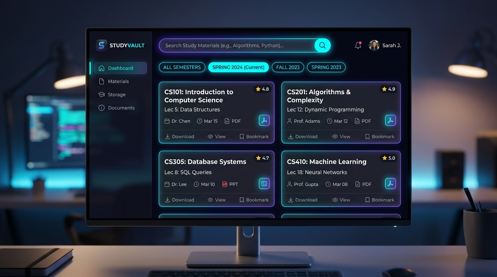
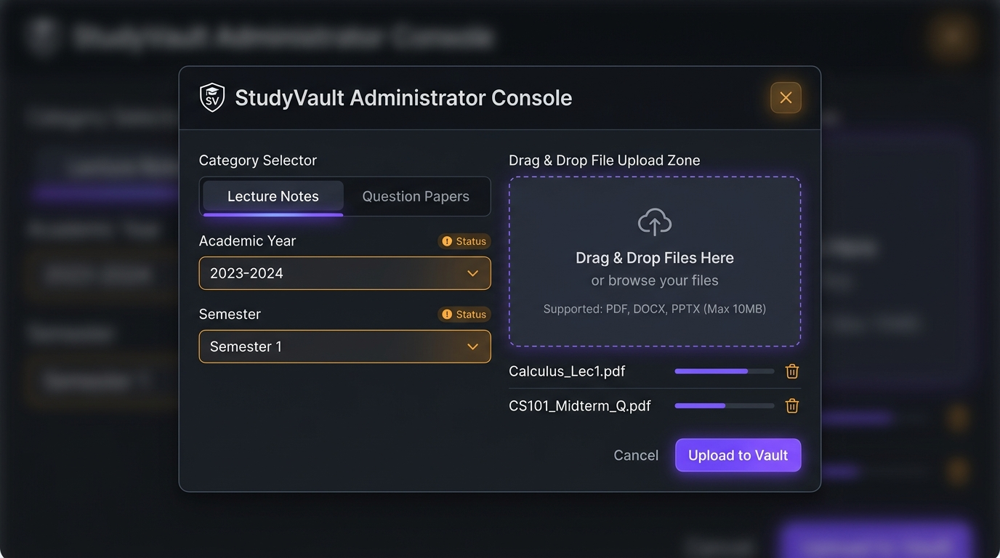

# StudyVault — Digital Study Material Management System
## Official System Use Case Specification & Complete User Manual
**Academic Year:** 2025–2026 | **Class:** T.Y. B.Sc. Computer Science | **Department:** Computer Science  
**Live Production URL:** [https://study-vault-psi-red.vercel.app](https://study-vault-psi-red.vercel.app)  
**GitHub Repository:** [https://github.com/prashikgaikwad2006-cell/study-vault](https://github.com/prashikgaikwad2006-cell/study-vault)  
**Compiled PDF Document:** [`StudyVault_User_and_Use_Case_Guide.pdf`](./StudyVault_User_and_Use_Case_Guide.pdf)

---

## 1. Executive Overview & Problem Addressed

In modern collegiate education, academic study materials—including lecture presentations, unit notes, previous years' question papers (PYQs), lab assignment solutions, and syllabus blueprints—are scattered across disorganized WhatsApp student groups, temporary Google Drive folders, and unindexed Telegram channels. This fragmentation results in severe disadvantages: broken links during exam preparations, outdated syllabi, unverified notes lacking academic authority, and repetitive file requests to professors.

**StudyVault** resolves this academic crisis by delivering an institutional-grade, syllabus-indexed, cloud-native repository. Built with a responsive glassmorphism user interface and backed by a Python/Flask REST backend with structured SQLite indexing, StudyVault provides instantaneous search, in-browser document previews, and strict role-based access control where **only authenticated faculty administrators have upload rights**, ensuring academic provenance and 100% spam-free study resources.

---

## 2. System Roles & Access Control Matrix

| System Capability / Feature | Student (Learner) | Faculty Administrator | Technical Enforcement & Security |
| :--- | :--- | :--- | :--- |
| **Browse & Filter Materials** | Full Access (All Courses) | Full Access | Public REST API (`/api/materials`) |
| **Live Multi-Field Search** | Instant Debounced Query | Instant Debounced Query | Client-side search indexing with `/` shortcut |
| **In-App PDF Document Preview** | Full Access (Embedded Modal) | Full Access | Sandboxed modal viewer; no download forced |
| **Verified Direct Download** | Unlimited One-Click | Unlimited One-Click | Automated download counter increment in database |
| **Personal Exam Bookmarks** | Personal Starred Drawer | Personal Starred Drawer | Client-side persistent storage synchronization |
| **Upload New Academic Files** | ❌ **DENIED (Disabled)** | ✅ **AUTHORIZED** | Server HTTP 403 Forbidden check; Admin session required |
| **Upload Button & Modal** | Hidden from UI | Active in Navigation Bar | DOM conditionally rendered upon Admin auth |
| **Supported File Types** | N/A | PDF, DOCX, PPTX, TXT, ZIP | Strict extension & MIME type validation (Max 32MB) |

---

## 3. System Credentials & Authentication Reference

| Role | Email Identifier | Password | Privileges | Fast Access Method |
| :--- | :--- | :--- | :--- | :--- |
| **Faculty Administrator** | `admin@studyvault.ac.in` | `admin123` | Full Admin & Upload | Click **`⚡ 1-Click Sign In as Admin`** in top bar |
| **Sample Student** | `aarav.cs@student.ac.in` | `student123` | Browse, Read, Download | Click `Sign In` → `Demo Student Login` |
| **Self-Registered Student** | `<student email>` | `<user created>` | Browse, Read, Download | Click `Sign In` → `Create an Account` |

---

## 4. Feature Breakdown & Operational Mechanisms (Konse Features Kya Work Karte Hai)

### Feature 1: Syllabus-Indexed Cascading Navigation
Organizes materials following university hierarchies: **Course → Semester → Subject → Material Type**. Selecting a course dynamically filters available semesters, and picking a semester populates only that semester's subjects. Students never have to hunt through hundreds of unindexed documents.

### Feature 2: Real-Time Debounced Global Search (`/` Shortcut)
An instant client-side search engine queries title, unit description, subject code, and uploader name simultaneously. Pressing the **`/` key** focuses the search bar immediately from anywhere on the webpage with a 250ms debounce for high performance.

### Feature 3: Academic Material Classification Badges
Every resource is clearly labeled with color-coded classification chips:
- **Lecture Notes** (Indigo)
- **Question Bank / PYQs** (Amber)
- **Syllabus Copies** (Emerald)
- **Reference Books** (Cyan)
- **Lab Manuals** (Rose)

### Feature 4: In-Browser PDF Document Previewer
Students can inspect notes without downloading. Clicking **`Preview`** opens an embedded full-screen modal reader showing the document, page rendering, file size, semester, subject, and uploading faculty information.

### Feature 5: One-Click Verified Direct Download
Clicking **`Download`** triggers an immediate binary file download while updating the download counter in the database. This provides faculty with real-time insight into high-demand exam topics.

### Feature 6: Exam Bookmarks / Saved Revision Drawer
Students click the **Bookmark icon (★)** to pin important notes into a dedicated drawer for rapid pre-exam revision.

### Feature 7: Faculty Administrator Upload & Integrity Vault
Restricted strictly to authenticated faculty. Enables multi-format uploads (PDF, DOCX, PPTX, TXT, ZIP up to 32MB) with automatic size calculation, file extension validation, and immediate curriculum database indexing.

### Feature 8: Real-Time Academic Statistics Dashboard
Displays dynamic counters in the header showing Total Materials, Cumulative Student Downloads, Active Courses, and Subjects.

---

## 5. UI Showcase

### Figure 1: StudyVault Student Portal Interface

*Modern glassmorphic interface with live search, cascading filters, subject chips, material cards, and preview/download controls.*

---

## 6. Step-by-Step User Guide (Website Kese Use Karni Hai)

1. **Open the Web Portal:** Navigate to [https://study-vault-psi-red.vercel.app](https://study-vault-psi-red.vercel.app) in any browser on laptop or mobile. No app installation is required.
2. **Choose Your Course & Semester:** Select your degree program (e.g., *B.Sc. Computer Science*) and semester (e.g., *Semester 5*).
3. **Filter by Subject or Resource Type:** Click any Subject pill (e.g., *Software Engineering*) or use the Type dropdown to isolate *Question Banks (PYQs)* or *Lecture Notes*.
4. **Use Fast Search with `/` Key:** Press `/` on your keyboard or tap the search box. Type keywords like *'Database'*, *'Python'*, or *'Agile'* for instant results.
5. **Preview Notes in Browser:** Click **`Preview`** on any card to read the complete PDF without using device storage.
6. **Download Verified Notes:** Click **`Download`** to save the verified PDF file directly to your device.
7. **Bookmark for Exam Revision:** Click the star / bookmark icon on important documents. Click **`Bookmarks`** in the top bar to access all pinned notes in one place.

---

## 7. Student Sign-In Guide (Sign In Kese Karna Hai)

1. **Open the Sign-In Modal:** Click the **`Sign In`** button at the top-right corner of the navigation bar.
2. **Instant Demo Student Login:** Click the pre-filled demo student button or type email `aarav.cs@student.ac.in` with password `student123`. Click **`Sign In to StudyVault`**.
3. **Create a New Student Account:** Click **`Create an Account`** at the bottom of the dialog. Enter your Full Name, College Email address, and a secure password. Click **`Register`**.
4. **Student Account Privileges:** Unrestricted reading, searching, previewing, bookmarking, and downloading across all curriculum subjects.

---

## 8. Administrator Login & Faculty Upload Guide (Admin Login Kese Karna Hai)

> **🔒 Strict Faculty Upload Access Policy:**  
> To uphold academic authenticity and prevent counterfeit notes, unverified documents, or malicious uploads, **the Upload feature is restricted to Faculty Administrators**. Public student uploading is deliberately disabled.

### Two Methods to Sign In as Administrator:

#### Method A: Instant 1-Click Admin Login (Recommended)
In the top navigation header or inside the Sign-In modal, click the bright amber button:  
**`⚡ 1-Click Sign In as Admin`**.  
The system instantly authenticates you as **Prof. Rajesh Sharma** (Admin ID: 1), issues the Bearer session token, and unlocks the **`+ Upload Material`** button in the header.

#### Method B: Manual Faculty Credential Sign In
1. Click **`Sign In`** in the top navigation bar.
2. Enter Faculty Admin Email: `admin@studyvault.ac.in`
3. Enter Admin Password: `admin123`
4. Click **`Sign In to StudyVault`**. Once verified, the Admin upload console is unlocked.

### Step-by-Step Document Upload Procedure for Admins:
1. **Click `+ Upload Material`:** Visible in the header after Admin login.
2. **Select Course & Semester:** Choose the degree (e.g., *B.Sc. Computer Science*) and semester (*Sem 1 to Sem 6*). The Subject dropdown immediately populates with the corresponding curriculum.
3. **Select Subject & Category:** Choose the Subject (e.g., *Advanced Java Programming*) and classify the material (*Lecture Notes, Question Bank, Syllabus, Reference Book*).
4. **Provide Title & Details:** Enter unit title and syllabus summary.
5. **Drag-and-Drop File:** Upload your PDF, DOCX, PPTX, TXT, or ZIP file (up to 32MB).
6. **Click `Publish to StudyVault`:** The file is immediately verified, stored, and published to all students worldwide.

---

## 9. Administrator Upload Console UI

### Figure 2: Faculty Administrator Upload Console & Security Modal

*Secure upload modal featuring Course/Semester cascading selectors, drag-and-drop file zone, format checks, and 1-click admin authentication.*

---

## 10. Technical Architecture & Deployment Details

| Subsystem Layer | Technologies Used | Architectural Role & Key Specifications |
| :--- | :--- | :--- |
| **Frontend UI / UX** | HTML5, Vanilla CSS3, Modern ES6+ JavaScript | Glassmorphism dark theme, zero bulky dependencies, 60fps micro-animations, instant client-side debounced search indexing. |
| **Backend REST API** | Python 3.12, Flask Framework | Modular RESTful endpoints for hierarchical filtering, streaming binary downloads, secure file upload processing, and token verification. |
| **Database & Storage** | SQLite 3 Relational Database Engine | Normalized relational schema (courses, semesters, subjects, materials, users, bookmarks). Automatic database seeding with 11 academic resources. |
| **Cloud Platform** | Vercel Serverless WSGI Edge Platform | Global CDN edge distribution, 24/7 high availability, automated continuous deployment pipeline synchronized with GitHub. |
| **Security & Auth** | PBKDF2 Password Hashing, Bearer Token Auth | Role-based authorization restricting file uploads to faculty administrators; server-side whitelist validation preventing unauthorized files. |

---

## 11. Frequently Asked Questions (FAQ)

- **Q1: Why is the `+ Upload Material` button not showing on my screen?**  
  **Answer:** The Upload button is visible only to Faculty Administrators. Click the yellow **`⚡ 1-Click Sign In as Admin`** button in the top bar or sign in with `admin@studyvault.ac.in` / `admin123` to unlock upload capabilities.

- **Q2: Can regular students upload their own study notes directly?**  
  **Answer:** No. Public student uploading is disabled to ensure 100% syllabus alignment and prevent malicious files or spam. Students submit their notes to faculty members, who verify and publish them through the Admin Console.

- **Q3: Does the website work on mobile devices and tablets?**  
  **Answer:** Yes. The layout is built using modern responsive CSS Flexbox and Grid. Filter dropdowns, search bars, and the PDF preview reader automatically adjust to any smartphone or tablet screen.

- **Q4: Do students have to pay or install extra apps to download documents?**  
  **Answer:** No. StudyVault is an open institutional project designed to provide barrier-free access. All notes can be previewed and downloaded completely free.

- **Q5: What happens if an Admin uploads an unsupported file format?**  
  **Answer:** The server enforces strict format validation. Only `.pdf`, `.docx`, `.pptx`, `.txt`, and `.zip` files under 32MB are accepted. Unsupported extensions (like `.exe` or `.bat`) are blocked with a clear warning.

---

**Project Certification:**  
This system documentation represents the official Use Case Specification and Operational User Guide for **StudyVault — Digital Study Material Management System**, developed as an academic capstone project for **T.Y. B.Sc. Computer Science** (Academic Year 2025–2026).  
*Live Production URL:* [https://study-vault-psi-red.vercel.app](https://study-vault-psi-red.vercel.app)
